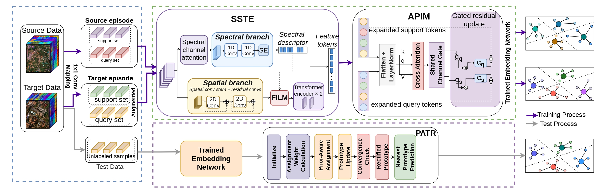

# SAPFSL

This is the official PyTorch implementation of **SAP-FSL: Spectral-Spatial Transductive Few-Shot Learning for Cross
Domain Hyperspectral Image Classification** by Md. Al-Samir Shuvo, Tanvir Rahman Mazumder, Azmain Haq, Avradip Datta Charu, Mir Faiyaz Hossain, Sejuti Rahman, and Shafin Rahman.

<!-- **Paper:** [[Journal/Conference]](link-to-paper) · [[arXiv]](link-to-arxiv) -->

## Overview

SAPFSL_PTL is a cross-domain few-shot learning framework for hyperspectral image (HSI) classification. The model is meta-trained on a source domain (**Chikusei**) together with a few labeled target samples, and evaluated on the target domain (**Indian Pines, Houston**) using only 1 to 5 labeled samples per class.

The framework consists of three main components:

- **Spectral-Spatial Transformer Encoder:** combines spectral channel attention, a 1D spectral branch with FiLM modulation, residual 2D convolution blocks, and transformer encoder blocks to extract joint spectral-spatial features.
- **Attentive Prototype Interaction Module:** a cross-attention module between support and query tokens with a channel gate.
- **Prototype Adaptive Transductive Rectification:** refines class prototypes using the unlabeled target pixels.



_Figure: Architecture of the proposed SAPFSL._

## Directory Structure

```
├── SAPFSL_IP.py          # training + evaluation script (Indian Pines)
├── utils.py              # datasets, samplers, data loading, augmentation
├── checkpoints/          # saved models (created automatically)
├── README.md
```

<!-- Datasets are kept outside the project folder and passed with `--data_dir`:

```
hsi-dataset/
├── Chikusei_imdb_128_9x9.pickle      # source domain (Chikusei, 128 bands, 9x9 patches)
├── Indian_pines.mat        # target hyperspectral cube
├── Indian_pines_gt.mat               # target ground truth
``` -->

## Requirements

- Python 3.8+
- An NVIDIA GPU with CUDA (the script has no CPU fallback)

```
pip install torch numpy scipy scikit-learn matplotlib
```

## Dataset

The following datasets are used:

- **Source domain:** Chikusei, preprocessed into a 128-band, 9x9-patch pickle file.
- **Target domain:** Indian Pines and its ground truth.

Place the three files in one folder and pass their names with `--source_file`, `--target_data_file`, and `--target_label_file`.

## How to run

```
git clone https://github.com/nullbyte669/SAPFSL.git
cd SAPFSL
```

```
python SAPFSL_IP.py \
    --shot_num_per_class 1 \
    --test_lsample_num_per_class 5 \
    --episode 10000 \
    --learning_rate 0.001 \
    --n_dataset 10 \
    --data_dir ./datasets \
    --source_file Chikusei.pickle \
    --target_data_file Indian_pines.mat \
    --target_label_file Indian_pines_gt.mat
```

## Citation

If you find this repository useful in your research, please kindly cite our work:

```
@article{xxx,
  author={...},
  title={...},
  journal={...},
  year={...}
}
```

<!-- ## Acknowledgement -->
